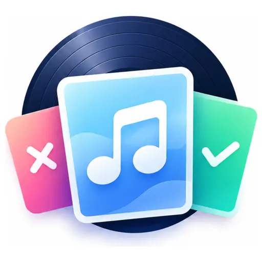
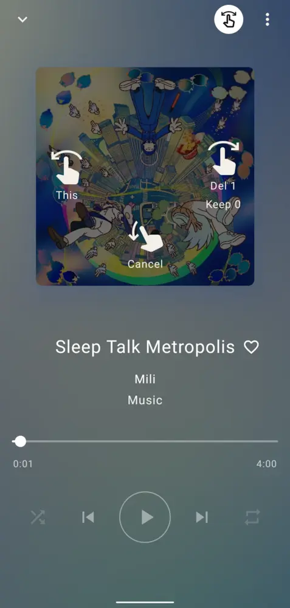
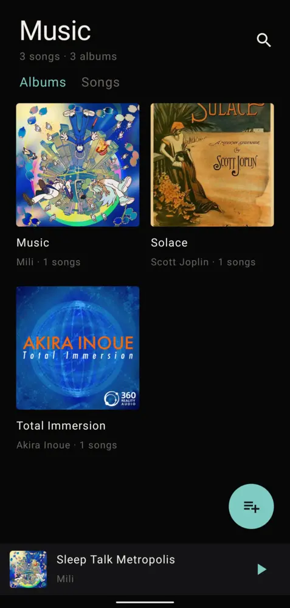
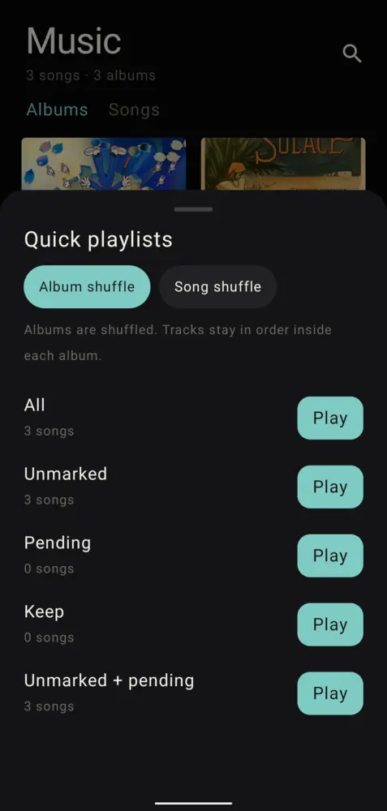

<p align="center">
  
</p>
<h1 align="center">Melique</h1>
<p align="center">A local music player built for triage — swipe the cover to mark, keep, or delete songs while you listen.</p>

<p align="center">
  &nbsp;&nbsp;&nbsp;&nbsp;
  &nbsp;&nbsp;&nbsp;&nbsp;
  
</p>

## Features

- Library: Albums, Songs. Quick playlist by mark, album shuffle or song shuffle.
- Player: Keep, Pending, queue, keep album, sleep timer, lock. Cover swipes change tracks. Select mode marks or deletes. Album delete skips kept tracks.
- Undo for 5 seconds with All files access.
- Artwork: system album art, embedded picture, `cover` / `folder` / `front`, then a monogram.

## Build

`local.properties` sets `sdk.dir`. minSdk 26. compileSdk 37.

```bash
./gradlew :app:assembleDebug :app:testDebugUnitTest
adb install -r app/build/outputs/apk/debug/app-debug.apk
```

## License

GPL-3.0. See [LICENSE](LICENSE).
